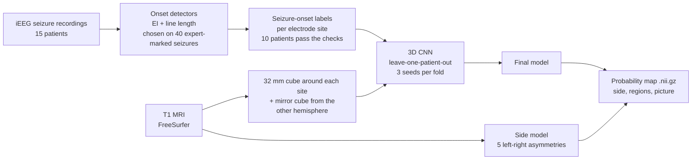

# Epileptogenic-zone localization from MRI

**A 3D CNN that learns from intracranial EEG where seizures start, and then predicts it from a T1 MRI alone.**

[](https://github.com/MohitMatrix66/epilepsy-ez-localization/actions/workflows/smoke-test.yml)


> [!WARNING]
> **This is a research prototype, not a clinical tool.** It was trained on 10 patients and tested on 20 more.
> Please read the [limitations](docs/LIMITATIONS.md) before you use or report its results.

In drug-resistant focal epilepsy, surgery can stop the seizures. To plan it, doctors first have to find the
brain area where the seizures start (the *epileptogenic zone*). Often this means intracranial EEG (iEEG): electrodes
implanted in the brain for several days. This project asks a simple question: **can a model learn from the iEEG
patients where seizures start, and then find that area on an MRI alone?**

Given a T1 MRI processed with FreeSurfer, the model returns:

- a **probability map** of the seizure-onset zone (`.nii.gz`, shown on top of the MRI in ITK-SNAP, 3D Slicer or
  Freeview);
- the **side** of the brain (left or right), from the CNN and from a separate side model;
- a **ranked list of brain regions**, a ready-made picture and a short text summary.

The model is trained and tested on the public **Penn 3T-7T Paired Epilepsy Imaging** dataset (30 patients, 15 of them
with iEEG). The scripts read it directly from AWS: no account is needed and only the files the project uses are
downloaded.

## Results (version 9)

| Question | How it was tested | Result |
|---|---|---|
| Which side do the seizures start on? | Final model on the **20 patients it was never trained on**. 15 of them have a one-sided clinical record. | **12 of 15 correct = 80%** (95% CI 55–93%). Fair score (AUROC) 0.84. Always guessing the most common side (left): 67%. |
| | The 10 MRI-only patients (no iEEG) with a one-sided record | 10 of 10 with a 6 mm grid (95% CI 72–100%); 9 of 10 with an 8 mm grid |
| Are seizure-onset sites scored above the other sites of the same patient? | Leave-one-patient-out on the 10 iEEG patients (679 electrode sites, 86 of them seizure-onset sites) | AUROC **0.73** (0.62–0.83), against 0.64 for anatomy alone. The difference is not significant. |
| Is the v8.1 shortcut (the caudate and ventricle fluid) gone? | Unseen patients: is the top region a deep structure? Is the score just the fluid in the cube? | **0 of 20** top regions in a deep structure (v8.1: 19 of 20). Correlation of the score with fluid: −0.09. |
| Where in the hemisphere? | Lobe of the top region against the clinical lobe | 8 of 14. **Not better** than always saying "temporal" (86%). |

**In short:** the side prediction is promising. The location inside the hemisphere is not patient-specific yet: it
mostly repeats the typical temporal-lobe pattern of the training patients. With 10 labelled patients and T1 images
only, this is mainly a limit of the data, not of the code. The [limitations](docs/LIMITATIONS.md) page explains why and
what would fix it.

The full numbers, the per-patient tables and every log are in [docs/RESULTS.md](docs/RESULTS.md) and
[results/v9/](results/v9).

## How it works



1. **Labels from iEEG** (`SOZ/`). For every seizure, two detectors look for where it starts. The Epileptogenicity
   Index sees low-voltage fast activity; line length sees rhythmic discharges. The method was chosen on an expert
   benchmark (40 seizures marked by 3–5 epileptologists), not by hand. A site is a seizure-onset site when it starts
   at least 2 seizures and at least 25% of them.
2. **MRI cubes** (`04_make_patches.py`). Around every electrode site the model gets a 32 mm cube (sampled every 1 mm,
   whatever the voxel size). It also gets the **mirror cube** from the same place in the other hemisphere, so it can
   compare left and right the way a radiologist does. The healthy mirror sites and cubes from the deep structures are
   added as "not onset" examples.
3. **3D CNN** (`05_train_cnn.py`). Four convolution blocks, about 0.44 M parameters, trained on a free Google Colab
   GPU. Leave-one-patient-out cross-validation with 3 seeds per fold. Every prediction is averaged with the
   left-right flipped cube.
4. **Whole-brain map** (`08_predict_mri.py`). The CNN runs on a grid over the cortex, hippocampus and amygdala. The
   deep grey structures are outlined as *not assessed*.
5. **Side model** (`07_lateralization.py`). A small logistic regression on five left-right differences: hippocampus,
   amygdala and thalamus volume, hippocampal T2 signal, and temporal cortical thickness.

The method in detail: [docs/METHOD.md](docs/METHOD.md).

## Quick start

### 1. Install

```bash
git clone https://github.com/MohitMatrix66/epilepsy-ez-localization.git
cd epilepsy-ez-localization
conda env create -f environment.yml        # or: python -m pip install -r requirements.txt
conda activate ez-localization
python tools/check_install.py --network    # must end with INSTALL OK
```

On Windows, use the Anaconda Prompt. Beginner-friendly steps for Windows, macOS and Linux:
[docs/GETTING_STARTED.md](docs/GETTING_STARTED.md).

### 2. Test the whole pipeline on synthetic patients (no download)

```bash
python tools/smoke_test.py                 # must end with SMOKE TEST PASSED (about 10-30 min on a CPU)
```

### 3. Use the trained model

Copy the trained model into `outputs/` once:

```bash
mkdir -p outputs && cp models/v9/* outputs/          # Windows: mkdir outputs  then  copy models\v9\* outputs\
```

Then run it:

| What | Command |
|---|---|
| A patient of the dataset (downloads only that patient's FreeSurfer files) | `python 08_predict_mri.py --subject sub-PID06` |
| **Your own MRI** (run FreeSurfer `recon-all` first) | `python 08_predict_mri.py --fs-dir /path/to/freesurfer/subject --name P31` |
| The 15 MRI-only patients, compared with the clinical record | `python new_patient_results/run_new_patients.py` |
| Every patient the model never saw: the honest accuracy table | `python 08_predict_mri.py --unseen` |

The results go to `outputs/predictions/<name>/`:

| File | What it is |
|---|---|
| `<name>_ez_probability.nii.gz` | probability map in the patient's MRI space |
| `<name>_ez_zone.nii.gz` | the model's zone: the highest-scoring 2% of the assessed grey matter |
| `<name>_ez_probability.png` | three views through the highest point, with the side and the top regions |
| `<name>_regions.csv` | mean probability of every brain region |
| `<name>_summary.txt` | side (CNN and side model), top regions, zone volume, settings |

To view a map in [ITK-SNAP](http://www.itksnap.org) (free):

1. Open the patient's `mri/norm.mgz` as the main image.
2. Add `<name>_ez_probability.nii.gz` as an overlay with the "Hot" colour map.
3. Open `<name>_ez_zone.nii.gz` as the segmentation.

### 4. Reproduce the training from scratch

[docs/REPRODUCE.md](docs/REPRODUCE.md) gives every step: the expert benchmark, the iEEG labels, the patches, CNN
training on Colab, the model report and the unseen-patient test. It downloads about 4 GB. When a script's message says
"README section N", it means section N of that guide.

## Repository structure

```
epilepsy-ez-localization/
├── 00_audit_dataset.py … 08_predict_mri.py   the model pipeline, run in this order
├── config.py               all settings (normally the only file you edit)
├── common.py               shared helpers: regions, cubes, mirror plane, side features, metrics
├── aws_data.py             reads the public dataset on AWS and downloads only what is needed
├── runlog.py               saves everything a script prints to outputs/logs/
├── SOZ/                    seizure-onset labels from iEEG: detectors, SOZ rule, contact table
├── benchmark/              40 expert-marked seizures (CC BY 4.0), used to choose the onset detector
├── colab/                  notebook that trains the CNN on a free Google Colab GPU
├── new_patient_results/    runs the final model on unseen patients and compares it with the clinical record
├── models/                 the trained version 9 model (CNN weights, model card, side model)
├── results/                the reported results: model report, metrics, per-patient tables, logs
├── docs/                   guides: getting started, reproduce, method, results, limitations, dataset
├── tools/                  install check, smoke test, synthetic data, expert benchmark, reports, plots
├── .github/workflows/      runs the smoke test automatically on every push
├── environment.yml         conda environment with the tested package versions
├── requirements.txt        the same packages for pip
├── CHANGELOG.md            what changed in every version, and why
└── CITATION.cff            how to cite this work
```

## Limitations

- **10 training patients and 86 seizure-onset sites.** This is too few to learn patient-specific locations, so the
  map peaks in the medial temporal lobe in almost everyone.
- **Electrodes only where clinicians suspected the onset**, so most of the brain has no label at all.
- **T1 only:** T2 is missing for 2 training patients and FLAIR for half of them. There are no healthy controls, and no
  resection masks or surgical outcomes.
- **Labels are automatic:** the dataset has no clinician seizure-onset marks.
- **Small left-right margins:** some sides change with the grid spacing.
- **Not a fully independent test:** the version 9 design was changed after the version 8.1 results on the same
  unseen patients were seen.

More detail, and what would fix each point: [docs/LIMITATIONS.md](docs/LIMITATIONS.md).

## Data and licences

- **Code:** [MIT](LICENSE).
- **Data:** not included in this repository. It comes from the *Penn 3T-7T Paired Epilepsy Imaging* dataset (Lucas et
  al., Pennsieve Discover, [doi:10.26275/aosz-hj9u](https://doi.org/10.26275/aosz-hj9u)), described in Imtiaz et al.,
  *Scientific Data* 2026, [doi:10.1038/s41597-026-07540-5](https://doi.org/10.1038/s41597-026-07540-5). Please cite
  it and follow its terms of use. See [docs/DATASET.md](docs/DATASET.md).
- **Trained weights** (`models/`): derived from that dataset; shared for non-commercial research use.
- **Expert benchmark** (`benchmark/`): CC BY 4.0, Ojemann et al. (Pennsieve Discover
  [doi:10.26275/dely-fzwx](https://doi.org/10.26275/dely-fzwx)); see [benchmark/README.txt](benchmark/README.txt).

## Citation

If you use this code, please cite it (GitHub's **"Cite this repository"** button uses [CITATION.cff](CITATION.cff)),
together with the dataset:

```bibtex
@software{mohit_2026_ez_localization,
  author  = {Mohit},
  title   = {Epileptogenic-zone localization from MRI with iEEG-derived labels},
  year    = {2026},
  version = {9.0},
  url     = {https://github.com/MohitMatrix66/epilepsy-ez-localization}
}

@article{imtiaz2026multimodal,
  author  = {Imtiaz, Tamjid and Lucas, Alfredo and Josyula, Mariam and Petillo, Nina and Wagenaar, Joost and
             Stein, Joel M. and Das, Sandhitsu and Sinha, Nishant and Davis, Kathryn A.},
  title   = {A multimodal epilepsy dataset of paired 3-Tesla and 7-Tesla MRI and intracranial EEG},
  journal = {Scientific Data},
  volume  = {13},
  pages   = {1320},
  year    = {2026},
  doi     = {10.1038/s41597-026-07540-5}
}
```

## Acknowledgements

- The Penn Center for Neuroengineering and Therapeutics, for the Penn 3T-7T dataset and the multi-expert seizure
  annotations.
- The ideas behind the version 9 side model come from AID-HS and from Caldairou et al. (*Neurology* 2021). The
  onset detector of version 6 builds on *Imprint* (Gascoigne et al. 2024).
- Parts of the code and documentation were written with the help of Claude (Anthropic). Some scripts still print
  "send this to Claude" from that review workflow; you can ignore those lines.

## Author

**Mohit**, [github.com/MohitMatrix66](https://github.com/MohitMatrix66)

Questions, bugs or ideas: please open an [issue](https://github.com/MohitMatrix66/epilepsy-ez-localization/issues).
